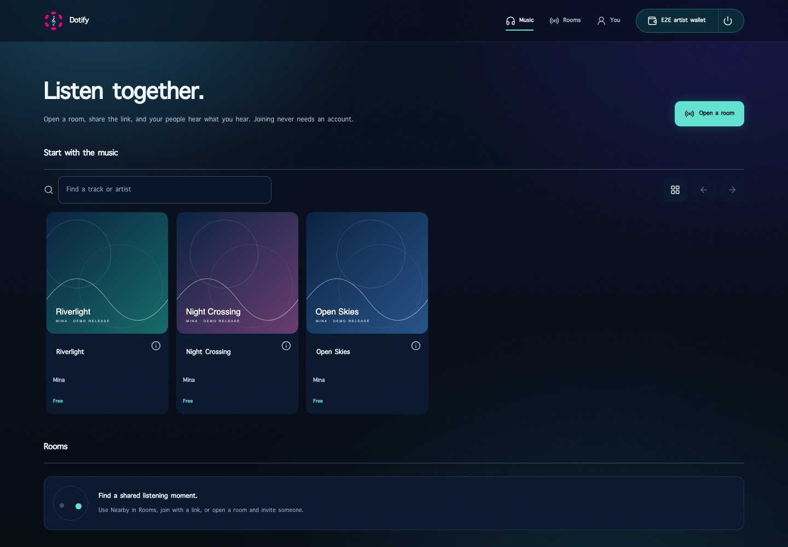
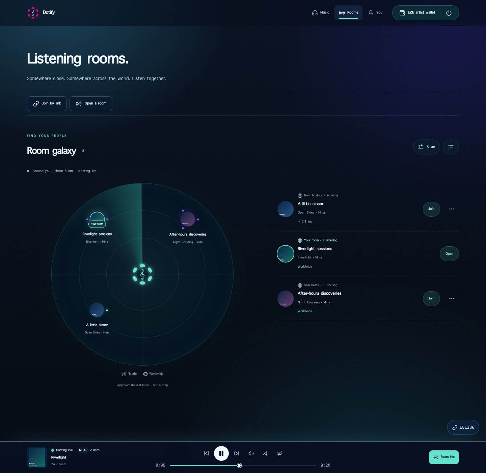
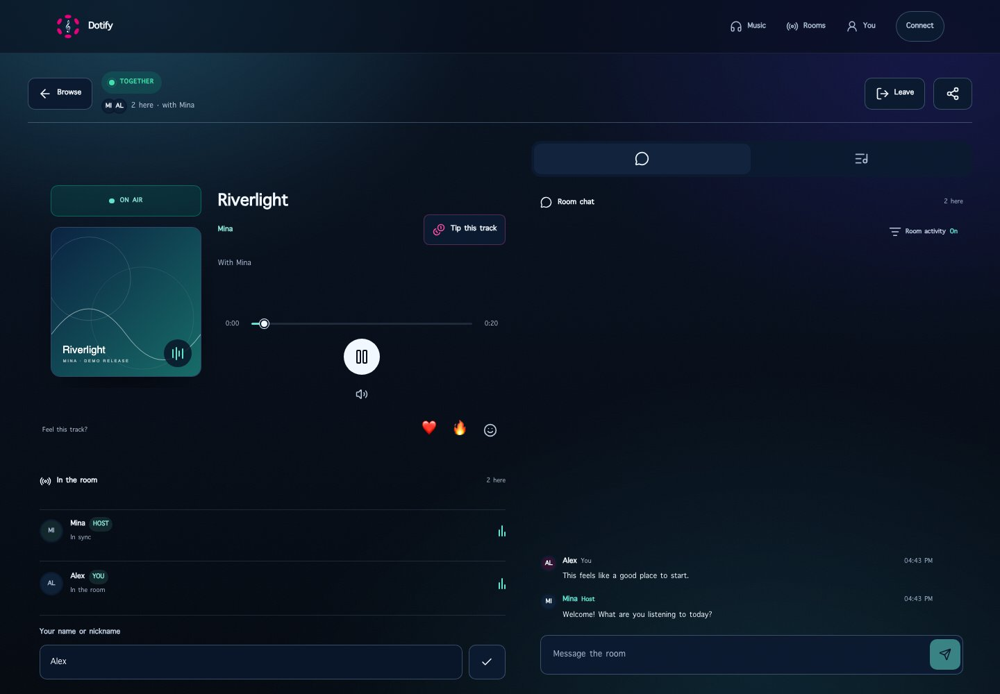
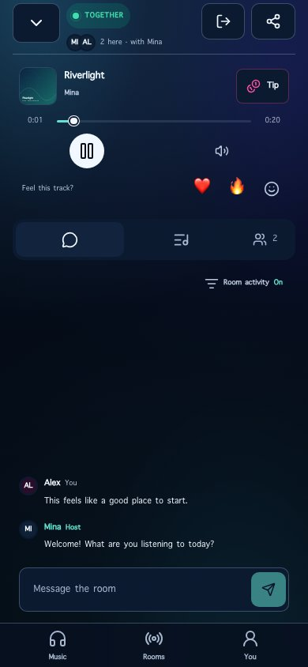
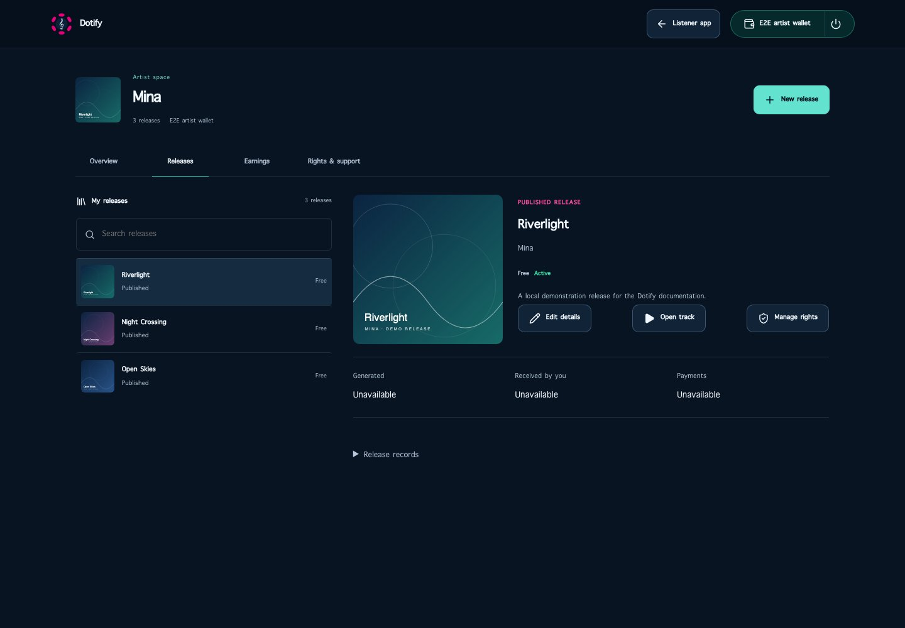

<p align="center">
  
</p>

# Dotify

**Music brings us closer.**

Dotify turns a shared link into a listening room. Discover music through the
people playing it, join the conversation, and support its creators. Artists
publish through their own smart runtime, keeping control over their catalog,
access policies, rights and value flows.

[Try the Web app](https://muzinga.netlify.app) ·
[Explore the project](https://knzeng-e.github.io/dotify/) ·
[Read the docs](docs/README.md) ·
[Develop locally](docs/how-to/develop-locally.md)

Dotify is in **testnet construction and validation** on Polkadot. Web and Product
DevNet are delivery targets; a deployed build is not an accepted public pilot.
Current device, reliability and payment checks live in the
[pilot release plan](docs/operations/pilot-release-plan.md).

Internal testing uses one authenticated streaming format. The [streaming-only
reset](docs/adr/0033-streaming-only-internal-reset.md) was deployed in Product
0.1.58; the latest [Product 0.1.63 and API/Web rollout](docs/backlog/implementation/evidence/product-0.1.63-rollout-2026-10-28.md)
preserves the current catalog while activating shared API state. Physical-device
and public-pilot acceptance remain separate gates.

## Listen together

1. Open a track in **Music**, then choose **Open a room**.
2. Give people a name to recognize you by, and optionally name the room.
3. Share its invitation link. Guests enter a nickname and join without a wallet.

Rooms start **Link only**. Hosts can choose **Nearby** or **Everyone** for
Worldwide discovery. The room galaxy combines opted-in nearby rooms with
Worldwide rooms, while private invitations remain available independently of
location. Nearby uses approximate areas, not a public map of people's positions.

[Hosting, joining and visibility](docs/how-to/listen-together.md)

## A look inside

These captures show the current Web interface with local demonstration data.
Room names, people and counts are illustrative, not live activity or evidence
of native Product support. [Capture source and reproduction](docs/images/release-preview/README.md).

**Discover music**



**Find a listening room**

The **Room view** picker offers **Radar**, **3D**, and **List**. Radar opens by
default; choosing 3D loads the optional graphics. All views use the same rooms
and Join flow, with Radar available when graphics or reduced-motion settings
prevent 3D.



**Share the moment**



<details>
<summary>Mobile listening and the artist studio</summary>

<p>
  
</p>



</details>

## For artists

The separate [artist space](https://muzinga.netlify.app/artists) brings together
onboarding, release publication, editorial metadata, access rules, royalty
splits and contribution settings. Verified artists can see aggregate activity
for their music and visit public rooms carrying it. Private-room identifiers
are not exposed through those aggregates.

| Access mode | Individual listening                                                                                                                              |
| ----------- | ------------------------------------------------------------------------------------------------------------------------------------------------- |
| Free        | No wallet required; the API verifies that the release is public.                                                                                  |
| Classic     | The runtime checks paid access. Payments use its configured native asset, currently PAS on the test network.                                      |
| Human free  | Access depends on a verified personhood requirement. End-to-end availability depends on the chain and Host; it is not a universal sign-in option. |

Room access is different: the **host** must have permission to play the track;
guests receive a WebRTC audio stream, never its source file or content key.
[Access policy](docs/explanation/access-control-model.md) ·
[Content protection and its limits](docs/explanation/content-protection.md)

## Identify your app version

Open **You → About Dotify**, without connecting an account. Product builds show
Dotify's version; Web builds show their build identifier. **Copy app details**
includes only public build information and audio capabilities. If copying is
blocked, open **Technical details** and select the text or take a screenshot.
Polkadot App's own version is separate and is not inferred from Dotify's version.

## Develop locally

Use **Node 22 and npm 10+**. On a fresh checkout, from the repository root:

```sh
npm ci --prefix web
cp web/.env.example web/.env.local
npm run dev:listen --prefix web
```

This starts the Web app at <http://localhost:5273> and room signaling at
<http://localhost:8788>. The example frontend configuration also points to a
local API; follow the [local setup guide](docs/how-to/develop-locally.md) for
catalog browsing, protected playback and artist uploads. A local blockchain is
not required to use the configured testnet.

For deterministic flows without real wallets, keys or uploads, use the existing
[browser fixtures](web/README.md#verification).

## How it fits together

| Component                                                              | Responsibility                                                                               |
| ---------------------------------------------------------------------- | -------------------------------------------------------------------------------------------- |
| [Web app](web/README.md)                                               | React, TypeScript and Vite; Music, Rooms, You and the separate artist studio.                |
| [API](docs/explanation/architecture-overview.md#backend-api)           | Catalog indexing, uploads, encrypted audio, signed sessions and access-checked key delivery. |
| [Signaling](docs/explanation/listening-rooms.md)                       | Room membership, ephemeral conversation, scoped discovery and WebRTC negotiation.            |
| [Artist runtimes](contracts/README.md)                                 | Artist-owned contracts for catalog, access and value flows on Paseo Asset Hub.               |
| [Product integration](docs/explanation/product-devnet-architecture.md) | Host account/runtime adapters and Bulletin/DotNS app distribution.                           |

Master key material stays server-side; Pinata credentials stay with the private
publication service. Audio travels over
WebRTC directly or through TURN when needed; signaling does not carry it.
Protection controls source distribution and key delivery, not recording after
someone is authorized to hear music.

[Architecture](docs/explanation/architecture-overview.md) ·
[Security model](docs/security/content-key-delivery-threat-model.md) ·
[Deployment configuration](docs/operations/deployment-configuration.md)

## Contribute and follow progress

Start with the [documentation map](docs/README.md) and
[implementation plan](docs/backlog/implementation/README.md). GitHub
[Project 5](https://github.com/users/knzeng-e/projects/5) tracks live work;
[dated evidence](docs/backlog/implementation/evidence/) records what was tested.
Reliability and verified artist/listener journeys come before feature expansion.

Create focused branches from tested `dev`, preserve the room guest's walletless
entry, and follow the [contribution rules](AGENTS.md) and
[PR writing guide](docs/explanation/pull-requests-as-knowledge-sharing.md).
See [Web verification](web/README.md#verification) for commands.

Deployment addresses and rollout identities belong in
[deployments.json](deployments.json) and the
[operations runbooks](docs/operations/deployment-configuration.md), rather than a
second list here. The Product publication process is
[documented separately](docs/operations/product-devnet-deployment.md).

[GPL-3.0 license](LICENSE) · [Project presentation](docs/presentation/dotify-showcase-2026.pdf)

[W36](docs/backlog/implementation/evidence/W36.md) is activated in the test
deployment: two public APIs share PostgreSQL trust/catalog state and one private
publication-custody service. The [migration runbook](docs/operations/shared-api-state.md)
protects preserved data and rollback. Artist access rules and anonymous room
entry are unchanged.
