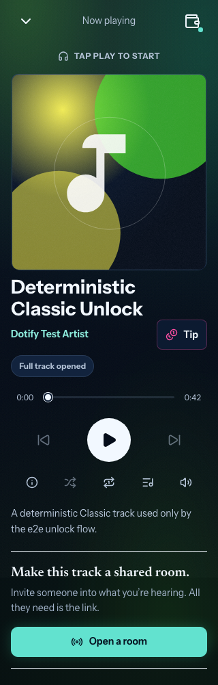
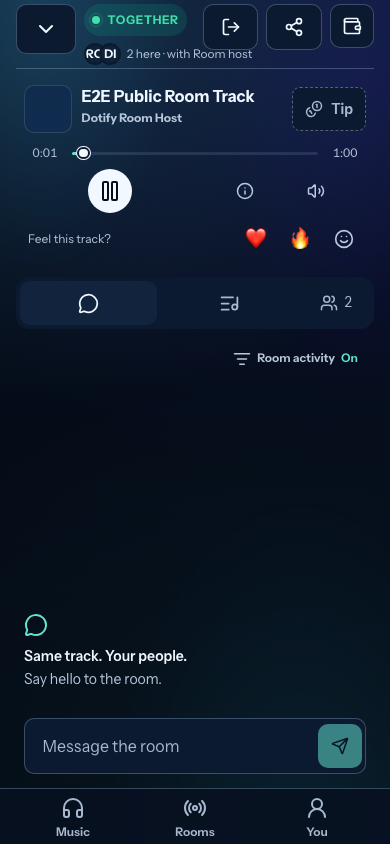
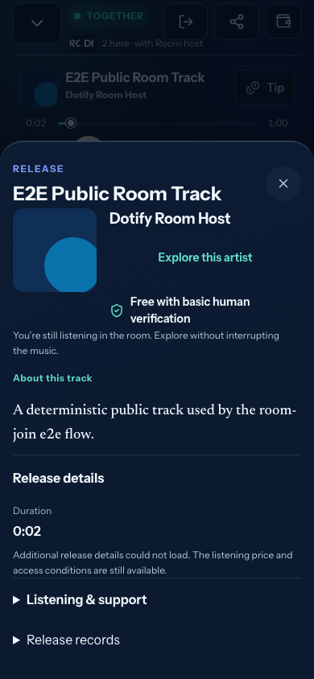

# Listening controls and room discovery — 2026-11-05

Refs [#388](https://github.com/knzeng-e/dotify/issues/388), following the owner's
[0.1.73 cross-client acceptance](product-0.1.73-rollout-2026-11-05.md).
This is a client implementation candidate, not a production rollout or native
lock-screen acceptance. Web and Product remain deployed as 0.1.73. The issue
stays open for publication and physical validation.

Base: tested `dev` `609d0d975583858c6793aac5904391065a4d509e`, whose Web tree
matches the already verified 0.1.73 candidate. Base dev CI 41957906904 is green.
Implementation commit: `0cacee6b028b95be8150f646383cefaefade709f`.

## Account access during listening

`PlayerAccountButton` opens the existing account sheet from the compact solo
header and room header. The sheet shows the current account and its existing
Disconnect action. The view need not return to Music. It reuses
`UiFeedbackProvider` / `AccountWalletModal` / `WalletProvider`; there is no second
session or disconnect implementation. The 44px control has an account label,
connection cue and visible focus through the existing button styles. Account
disconnect still retires protected sources, keys and pending producers through
the merged #386 path, and reconnect does not autoplay or pay.

## Discovery belongs to the current room

The player transport now exposes About this release to room hosts and guests.
`roomReleaseDetails` enriches only the current room hash/runtime identity with a
matching catalog release. A missing/ambiguous match remains a labelled host
snapshot; an unrelated solo selection is never substituted. Only explicit
snapshot fields are copied, so extra wire fields cannot impersonate a catalog
release with payout/provenance data. Arbitrary HTTP
metadata URLs are not followed from an unverified snapshot. Unknown listening
terms remain unavailable rather than being treated as free or authorized.

`ReleaseDetailsDialog` reuses the public release/credit/artwork reader, with no
payment, key, room-leave or transport action. Its metadata resource is scoped to
the current reference: stale responses cannot display another track's credits.
The dialog stays mounted while the room track changes, preserving its history
entry and focus. Opening it normalizes the already visible Player history entry
so closing a sheet on an auto-joined invitation does not return to Rooms.
Explore this artist uses the existing public profile while room membership and
audio remain active; return to the room is explicit. Payment/contribution
routing continues to use its stricter existing resolver, independently of this
read-only discovery enrichment.

## System artwork and controls

`PlaybackProvider` selects metadata from the same local/room authority as the
visible player. System controls remain available for explicit pending preparation
so Pause can cancel deferred autoplay; source failure/disconnect/dismissal clears
metadata and handlers. Calls delegate to the existing `usePlayback` owner, and
retired callbacks cannot play an unavailable source. Guests receive local
play/pause, never host next/previous/seek authority.

`systemArtwork` resolves full IPFS/public image references through existing
asset routing instead of appending an `ipfs://` or `dotify:cover:` marker to a
gateway URL. Immutable artwork reuses the bounded public cache and native
Bulletin reader. Cached/generated SVG covers are rasterized to a 640px PNG data
URL for the system; the generated fallback uses the same seed/artwork factory as
`CoverImage`. No page-local blob URL is handed to the native system for that
path. Decoding is bounded, late results are ignored after cancellation, and a
fresh `MediaMetadata` object publishes the completed image. A shared public-cache
read may finish after cancellation, but cannot restore retired metadata. Artwork
never blocks audio or asks for a wallet/content key.

Previous/next use existing queue/history/access rules. Relative ±10-second
handlers are cleared; absolute/foreground seeking remains available. Unsupported
Media Session methods fail softly. The pinned Product SDK exposes no separate
media-control port used by this candidate; it retains feature-detected browser
Media Session without adding permissions or a private native bridge.

The [W3C Media Session model](https://w3c.github.io/mediasession/#metadata)
allows the user agent to select the active session, displayed artwork and
platform UI. App registrations and browser image decoding do not prove the
actual lock-screen layout, image format support or Host background lifecycle.
These still need evidence per OS/Polkadot app version.

## Verification

- Unit suite: 1,077 tests / 141 files pass. After the final snapshot-field guard,
  the 14 artwork/action/presentation tests pass again.
- Chromium: 50 scenarios pass across Classic access, continuous player, room
  joins, player presence and the new controls. The live-room discovery test
  passes again after the final explicit snapshot-field copy and guest metadata
  guard: host changes update an open guest sheet, artist navigation preserves
  audible remote playback, and guest content-key requests remain zero.
- WebKit: four focused scenarios pass at 320/390/430px and with a delayed public
  image response. Actual browser decoding confirms the generated descriptor is
  a 640×640 PNG. Disconnect keeps the Player view while clearing protected audio,
  metadata and handlers; late artwork cannot resurrect them.
- Web build, frozen Product DevNet build, formatting and whitespace checks pass.
  Lint has zero errors and the two pre-existing `App.tsx` effect-dependency
  warnings. Existing bundle-size/Browserslist notices remain; no dependency or
  version update is included.
- CI adds this focused WebKit suite to the existing browser job. Base dev CI
  [41957906904](https://github.com/knzeng-e/dotify/actions/runs/41957906904)
  passed; branch CI must separately pass before merge.

Controlled browser probes observe real application action registration and PNG
image decoding, not a native lock screen. Room scenarios use real local signaling
and WebRTC with synthetic audio and no live wallet, key service or blockchain
transaction. The Previous-history test explicitly seeks to the intro first:
after three seconds, Previous intentionally restarts the current track, so
wall-clock delays must not select the wrong branch in a history regression.

Synthetic-fixture captures, inspected from the passing Chromium run:

| Player account, 320px | Room discovery, 390px | Current release sheet, 390px |
| --- | --- | --- |
|  |  |  |

## Deployment and remaining gates

No environment, origin/CORS, service, secret, grant, storage admission, contract,
media or Product version change is made. No external publication/renewal or
artist payment is executed. See the updated client-validation entry in the
[deployment runbook](../../../operations/deployment-configuration.md).

After review and normal matching Web/Product delivery, verify direct account
access on narrow mobile layouts; room detail/profile browsing with audible
continuity and guest boundaries; lock-screen title/cover and actual previous/
next with an eligible queue; and cleanup on disconnect/dismissal. Record OS,
browser/Polkadot app and deployed version. A browser stub is not device evidence.
Retain the earlier 0.1.73 accepted stop/recovery reports without treating them as
acceptance of this new UI. Signed unentitled access, account switching,
room-guest silence, Bulletin conservation and off-volume recovery remain
separate production gates. No additional storage backend is introduced.
