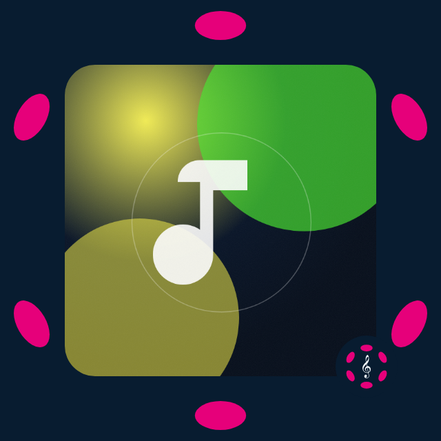

# Room startup, device interruptions and system artwork — 2026-11-06

Refs #395 and #388. Implementation candidate from tested dev `7b170507`.
No deployment, service restart, musical upload, policy change or renewal.

## Owner evidence and scope

The owner reports eventual **Adang Fobe** delivery at Web and Desktop guests on
two matching 0.1.77 tests, with long startup, intermittent audio-slow/unavailable
errors and repeated retries. Locking the host phone silences both outputs;
unlocking restores sound. Apparent background clock advancement is reported,
not measured. [The delivery record in #394](https://github.com/knzeng-e/dotify/pull/394)
keeps that feedback distinct from the eight-second acceptance.

This slice addresses demonstrated client gaps and adds evidence for the remaining
native failure. It does **not** establish that arbitrary full-length startup or
locked/background phone hosting is now reliable. #395 stays open.

## Preparation is separate from room creation

`useCatalog.selectTrack` now returns `preparationFailed` for failed or superseded
selection, including global-deadline expiry. `ListenerShell.executeArtistRoom`
does not issue `room:create` for that result or a rejected preparation. The
existing player retains the failure/retry action. A denied host's intentional
access-gated Room remains supported; media failure is not reclassified as denial.
A valid resolved URL still precedes native metadata and audible readiness.

This removes an actual path that created a silent Room after preparation had
already failed. It does not claim to diagnose every slow request on the phone,
make native readiness synchronous, shorten the track or relax the existing
60-second startup / 40 MiB bounds. A `compatibility-ready` startup observation
separates complete authenticated retrieval/container assembly from subsequent
media-element/context/capture activation. Existing first-object, authorization,
metadata, playing and failure observations retain their meanings.

## Native output policy and interruption ownership

One graph routes normalized audio both to the host monitor and the WebRTC
stream. `hostAudioOutput` now binds its lifecycle to that exact media generation,
including the fallback graph in `useSession`. Where supported, it requests
`navigator.audioSession.type = 'playback'` while real outputs exist. A shared
lease restores the previous type after the last output retires, unless another
owner has changed the policy. Missing/rejected APIs do not block ordinary audio.
This is an optional request to the platform, not background permission or a
native entitlement. See the [Audio Session draft](https://w3c.github.io/audio-session/).

After the graph has run, an observed suspended/interrupted/closed state freezes
the currently playing media element at its position and silences both legs.
The persistent player displays **Audio interrupted · tap Play to resume**; Room
controls offer **Resume audio**. The normal explicit Play path resumes the graph
and the element. Visibility, pageshow and later context recovery never invoke
play, so they cannot override voluntary Pause, access/account invalidation,
source retirement or room exit. A suspended initial graph is not mistaken for
an interrupted playing one. Native resume is bounded to three seconds; retirement
removes all event handlers and late completions cannot revive the old element.

This is deliberate fallback behavior when the platform interrupts playback,
rather than silently consuming the track or repeatedly attempting to defeat OS
policy. No microphone, oscillator keepalive, new relay or clear guest URL is
introduced. The [historical WebKit issue](https://bugs.webkit.org/show_bug.cgi?id=261554)
is supporting context (marked fixed), not proof of the current phone's cause.
Actual native background continuity still needs matching physical evidence and
may require a Host-side change outside this client repository.

## Local diagnosis without production telemetry

`window.__DOTIFY_AUDIO_STARTUP__.snapshot()` now includes `output`: at most 96
observations of context state/time, media time/paused/readiness, visibility,
optional session type/state, event time and a local generation number. Attachment,
resume, metadata, playing, waiting, pause, visibility and retirement are recorded.
No URL, key, wallet, room code, participant identity or audio sample enters this
new series. It stays in memory, clears with the existing snapshot API, and is
not sent to a service or persisted. It does not measure audible sound or sender
energy; the browser regression independently measures received PCM energy.

The existing First-sound readiness panel adds **Copy audio diagnostics**. It
explicitly copies a bounded `dotify.audio-diagnostics.v1` report with public build
SHA, phase timings and output states. Host source/attempt identifiers, CIDs,
gateway URLs and arbitrary error detail are omitted; paths are restricted to
known streaming object forms. It does not require starting a timing sample,
change the current attempt, persist a report or send anything to a service.
Clipboard denial leaves a plain retry-in-browser message. A redaction regression
checks malicious source/detail/build strings do not leak into the report.

For a matching phone attempt: copy this report after a slow
start and again after lock/unlock; distinguish download/container completion,
media readiness and graph state/clocks. An apparently running context can still
be stalled by a platform without a state event; this slice cannot infer that
failure from a status flag alone. Measure it before changing transport budgets.

## One recognizable system cover in solo and Room

`systemBrandedArtwork` places the cover in an inset rounded frame, surrounded by
the six original pink petals and a compact complete Dotify mark. No room count,
role, host attribution or small footer text is painted into the picture. Solo
and Room use the same public-artwork resolver and PNG composition; ordinary title
and artist remain unchanged, with a stable `Dotify` album label. Room membership
and count changes no longer regenerate metadata/artwork. The actual dock's room
information is unchanged.

Original artist assets remain intact. Existing public cache, decode deadline,
aborted-source checks and disconnect cleanup apply. A CORS/decode failure may
leave the original native-fetchable cover as fallback; artwork cannot hold up or
break audio. OS/Host control actual size, metadata display and caching. The
included image is a synthetic generated cover, not an artist recording or an
actual native lock-screen capture.

## Validation and remaining gates

- Unit suite: 1,103 tests. Lifecycle regressions cover playback-policy ownership,
  clock-preserving interruption, no visibility/OS autoplay after pause, bounded
  stalled resume, retired-generation isolation and bounded identifier-free data.
- Web and frozen Product builds pass. Lint has no errors; the two existing
  App.tsx dependency warnings remain. Build retains existing chunk-size and
  Browserslist notices; no dependency change.
- Chromium: real normalized audio → WebRTC received-energy measurement before
  interruption and after explicit recovery; source stays paused between them,
  and voluntary Pause remains authoritative. Five startup/access cases cover
  progress, new denial after cached compatibility media, global expiry, stale
  expiry isolation and the failed-room-preparation result.
- WebKit: authenticated complete AAC Blob → normalized WebRTC received energy
  passes. These are local synthetic browser checks, not an iOS lock test.
- System artwork: solo at 320/390/430 px, Room attribution/PNG/brand, late cover
  response after disconnect and metadata cleanup are exercised in Chromium and WebKit.
  The PNGs were visually inspected; native rendering remains a delivery gate.

After review and matching client rollout: repeat full-length foreground startup
with timing evidence, confirm Web/Desktop sound, then test actual phone lock and
unlock, position, explicit recovery, voluntary Pause, account disconnect, next
and guest mute. Do not certify background continuity from successful simulation
of `AudioContext.suspend()` or from a running media clock. Keep #395/#388 open
until their remaining device acceptance is captured.
