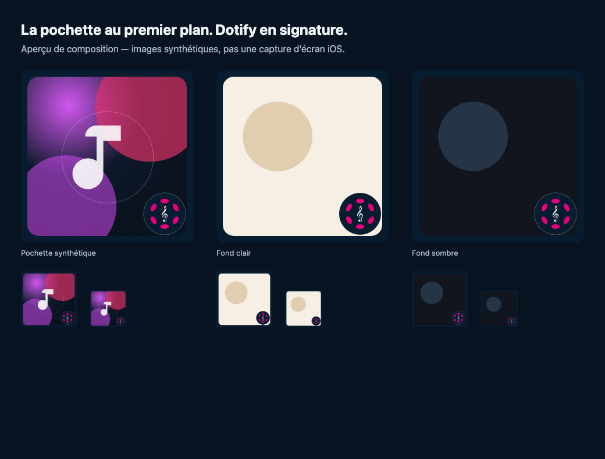

# Cover-first system artwork signature

Refs #388. Based on tested dev `4999bce6`; visual candidate, not deployed.

## Design

Phone feedback favors the bottom-right Dotify logo but finds the surrounding
petals excessive. The shared Canvas renderer removes that outer decoration,
expands the rounded cover from 452 to 592 pixels within the 640-pixel square,
and enlarges the complete original mark from 68 to 120 pixels. An opaque blue
badge with a thin neutral outline makes the mark readable across light, dark
and busy artwork. The badge remains wholly inside the canvas and overlaps only
the cover’s bottom-right corner. This tradeoff preserves a large cover instead
of reserving a wide decorative frame. The small petals belonging to the logo
itself are retained as part of the original brand geometry.

Only `web/src/features/player/systemBrandedArtwork.ts` changes runtime behavior.
Both solo and Room already use that renderer through `systemArtwork.ts`. Title,
artist, playback ownership, public artwork caching, cancellation and original
URL fallback are unchanged; the original uploaded cover is never modified. No
new image requests, keys, storage writes or native action changes are introduced.

## Validation

- Existing Chromium and WebKit listening-controls suites: 5 cases per engine,
  exercising generated PNGs in solo and Room, attribution, disconnect cleanup
  and delayed artwork that must not restore retired metadata.
- Web and frozen Product DevNet TypeScript/production builds pass; focused lint
  and offline backlog validation pass. Existing bundle-size, Browserslist
  and dependency annotation notices remain.
- The preview uses the real Canvas renderer, visually inspected at full and
  96/64 pixel sizes with synthetic illustrated, light and dark covers. It is
  not an iOS screenshot. No new test mirrors the renderer’s coordinates.

Matching deployment and physical lock-screen appearance remain to be checked.
The OS/Host controls scaling and caching, and the existing CORS/decode fallback
can show the original unbranded image. #388’s native navigation acceptance is
not completed by this visual-only change.
