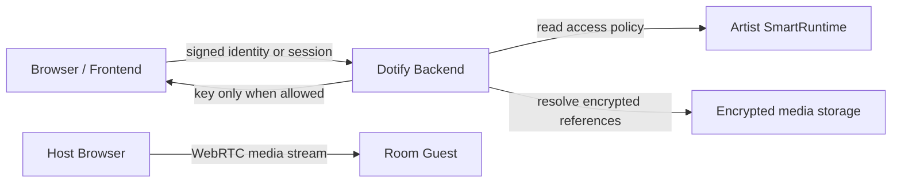
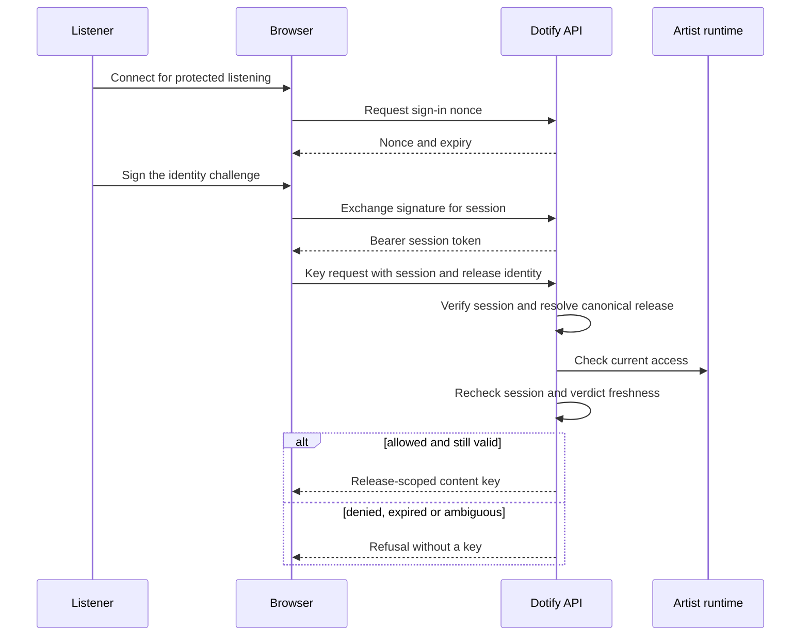
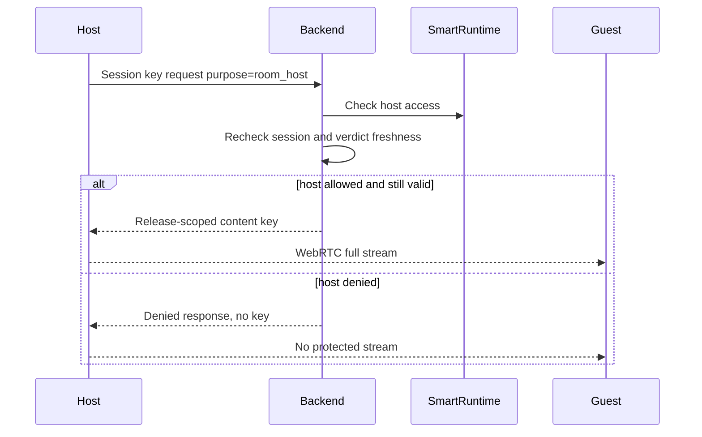

# Dotify content-key delivery threat model

## Purpose

This document defines what Dotify's content-key delivery protects, what it does not protect, and which boundaries must be preserved during implementation.

Dotify should be honest: this is protected distribution access, not absolute DRM.

## Assets to protect

- Full encrypted audio source files.
- Per-track content keys.
- Backend master secrets, retained key-version secrets, or key derivation material.
- Pinata upload credentials.
- Wallet-signature challenge integrity.
- Access-policy correctness.
- Artist runtime trust assumptions.

## Actors

| Actor      | Description                                                 |
| ---------- | ----------------------------------------------------------- |
| Artist     | Publishes protected tracks and defines access policy.       |
| Listener   | Requests individual playback or joins a room.               |
| Host       | Streams audio into a room.                                  |
| Room guest | Receives WebRTC stream from host.                           |
| Backend    | Validates signatures, checks runtime access, delivers keys. |
| Attacker   | Attempts to obtain source files, keys, or replay access.    |

## Trust boundaries



## Core security rules

- Production content keys must never be bundled into the frontend.
- Pinata credentials must not be exposed in Vite frontend variables.
- Backend must verify wallet signatures server-side.
- Signed challenges must include content hash, requester address, purpose, chain ID, nonce, and expiry.
- Nonces must not be replayable.
- Backend must check `musicAccCanAccess` before key release.
- Backend must fail closed on RPC/access ambiguity.
- Room listeners must never receive content keys.
- Room listeners must never receive encrypted source files through the key-delivery path.
- Encrypted refs that name a key version must be resolved only with that retained
  version secret; missing versions fail closed instead of falling back silently.

## Individual playback threat model

The current frontend signs in once, then uses a bearer session as described in
[session authentication](#session-auth-sign-once-listen-freely-ticket-24-p2).
Free tracks use the wallet-free route. The older per-track signed route remains
accepted for older clients. All paths resolve the canonical release and its
current access policy before deriving a key.



### Threats

| Threat                        | Mitigation                                                                                                 |
| ----------------------------- | ---------------------------------------------------------------------------------------------------------- |
| User extracts frontend bundle | No production key material in bundle.                                                                      |
| Replay old signature          | Nonce and expiry, one-time use.                                                                            |
| User lies about access        | Backend ignores frontend access booleans and reads runtime.                                                |
| RPC unavailable               | Fail closed for key release.                                                                               |
| Leaked content key            | Keep key scoped to track/release; remember that rotation cannot retract a key already learned by a client. |

## Room playback threat model



### Key point

The host may receive a content key if authorized.

Room guests do not receive a key. They receive only the WebRTC media stream.

### Threats

| Threat                                              | Mitigation / boundary                                                               |
| --------------------------------------------------- | ----------------------------------------------------------------------------------- |
| Guest tries to fetch source file                    | Guest has no content key and no key request path.                                   |
| Guest records WebRTC stream                         | Not prevented. This is outside Dotify's distribution-access protection.             |
| Unauthorized host tries protected track             | Backend returns a denial response, no key, and the host streams no protected audio. |
| Host shares decrypted audio outside Dotify          | Not fully preventable once host is authorized. Document boundary.                   |
| Malicious client claims purpose=room_host for guest | Signature requester is checked; room listeners are not given key-delivery UI/path.  |

## Non-DRM statement

Dotify does not promise that audio cannot be recorded after playback.

Dotify protects access to full source files and content keys. It does not prevent analog capture, screen/audio recording, or redistribution by an authorized malicious host.

Do not describe Dotify as perfect DRM.

## Access modes and the retired preview boundary

Access model v2 (ticket 24) gives every track an artist-chosen mode:

- `free`: the key service releases the content key with no authentication
  (POST /free-key). The backend still verifies the mode on-chain first
  (musicAccCanAccess probed with the zero address), so a track flipped back to
  a gated mode blocks subsequent Dotify key requests once the backend verifies
  the changed policy. Encryption is an access-policy mechanism, not revocation
  of keys already learned: an earlier recipient can retain a key and ciphertext.
  See [access policy limits](../explanation/access-control-model.md).
- `classic` (paid) and `human-free` (Proof of Personhood): wallet-signed key
  requests with the on-chain check, unchanged.

The 42% preview assets (ticket 18) are retired: denials no longer carry a
degraded playback mode - an unauthorized listener gets a reason plus an unlock
CTA and no audio. Already-pinned manifests may still carry `previewCID`; the
field is ignored and no new manifests produce it.

## Content-key versions and recovery boundary

Backend uploads use explicit `dotify-content-key-vN` secrets. New encrypted
audio refs include the version as `dotify:enc:v2:key-vN:ipfs://<CID>`, and key
delivery derives the same scoped key only after resolving the canonical release.

Operational rules:

- `CONTENT_KEY_MASTER_SECRET` is a compatibility secret for legacy v1 and the
  default release-bound v2 scope.
- `CONTENT_KEY_MASTER_SECRETS` retains a JSON map of version to secret, while
  `CONTENT_KEY_ACTIVE_VERSION` selects the version for new uploads.
- Rotation is additive. Old ciphertext remains readable only while its exact
  version secret remains configured.
- Missing key versions, malformed scopes, wrong release identity, and ambiguous
  catalog state fail closed.
- If a version secret is compromised, changing config protects only future
  uploads. Recovery may require re-encrypting affected audio and publishing
  updated release references.
- While the backend remains indispensable for content-key custody, Dotify must
  not claim complete artist-sovereign recovery. Artist export and
  alternative-operator handoff need a separate authenticated custody design.

## Session auth: sign once, listen freely (ticket 24 P2)

One SIWE-style SIGN_IN signature (nonce + expiry + replay protection, same
fail-closed order as key requests) establishes a signed-in identity. Bearer
tokens last **two hours** and can renew within the original **24-hour** wallet
sign-in window. Renewal does not move that original deadline. Later key
requests carry the token instead of a fresh signature. The defining constants
and verification paths are in
[sessionTokens.ts](../../services/api/src/services/sessionTokens.ts).

Properties and boundaries:

- The token proves identity only. Every key request still runs the on-chain
  access check for its own track against the token's address - a token never
  grants access by itself.
- Tokens are HMAC-SHA256 over validated claims. The signing key is HKDF-derived
  from the dedicated server-side `SESSION_SECRET`, not the content-key master.
  A previous session secret can be retained during an explicit bounded rotation.
  Use [shared-state configuration](../operations/shared-api-state.md#topology-and-configuration)
  for secret ownership and rotation inputs; never publish their values.
- A stolen token is bounded by TTL, server-side revocation (logout, also
  triggered by wallet disconnect in the app), and the fact that it can only
  fetch keys the address could already obtain.
- In shared mode, PostgreSQL is authoritative for session renewal and
  revocation across public API replicas. Local single-node mode retains the
  file-backed revocation implementation. Logout must not acknowledge success
  before durable storage accepts it; a failed write returns an error. Preserve
  the namespace, signing inputs and stable epoch during replacement. See
  [shared API state](../operations/shared-api-state.md).
- The frontend caches identity tokens by API URL, account, chain, and signing
  identity. Memory remains authoritative when persistent browser/Host storage
  cannot be written. The 60-second refresh margin and server expiry remain in
  force; storage failure does not extend a token or remove per-track access checks.
- A disconnect immediately stops local token reuse and invalidates pending
  sign-ins. Before removing an active cache entry, the client retains its token
  and expiry in a separate API-scoped, inactive logout queue. Only logout uses
  these credentials; neither playback nor upload can reactivate them. HTTP 503
  and transport failures retain them for a coalesced retry on app startup,
  foreground/network return, once per foreground minute, or the explicit retry
  action. At most four logout requests run together, each bounded to 15 seconds.
  Successful responses acknowledge durable revocation; failed active-cache
  cleanup retains the inactive marker across reload. Expired queue entries are
  discarded after a five-minute clock margin. This does not extend server TTL.
- A shared logout worker releases its own promise slot before settling. Callers
  recheck entries queued during a successful empty flush before reporting
  success; a failed flush rejects rather than looping network retries.
- If browser/Host storage cannot be written, retries remain memory-only and the
  UI warns that server sign-out is incomplete, with an instruction to keep the
  app open. A closed page cannot guarantee delivery in that condition. A session
  returned after disconnect is queued for revocation rather than installed.
  A typed failure subscription immediately surfaces incomplete revocation for
  such late sessions; cancellation does not silently defer the warning until
  the next lifecycle timer.
  A late 401 for an old token must not erase a newer token installed by another
  request. Tokens are not written to diagnostics or exposed in UI messages.
- A delayed logout result can update only its own feedback operation. A newer
  payment's status cannot be replaced by a logout success or failure; pending
  logout warnings defer while another feedback operation is displayed.
- Legacy address-only cache entries are not reused across unverified scopes.
  Upgrading can require one new sign-in; Free playback and room guests are
  unaffected. Explicit sign-out also removes/revokes readable legacy entries.
- The frontend requires session authentication for protected listening. A
  missing route or `SESSION_NOT_CONFIGURED` response fails closed without a
  per-track signature (negative capability cache: 30 seconds). Generic network,
  503 and ambiguous 401 failures retain an established token. Only typed
  `SESSION_EXPIRED`, `SESSION_REVOKED` or `SESSION_RESTARTED` responses renew it
  once. If the new token is rejected too, or exchange fails after wallet
  approval, automatic playback retries cannot sign again: explicit sign-in or
  disconnect/reconnect clears an in-memory interruption latch. The API still
  accepts its legacy signed route for older clients; the current frontend never
  uses it. Requests have a 15-second HTTP budget, excluding wallet approval.

### In-flight requests and expiry

An access read can finish after the listener disconnects or its verdict expires.
The [key routes](../../services/api/src/routes/keys.ts) therefore recheck the
session after asynchronous access reads and check an access verdict's
`validUntil` immediately before derivation. An expired verdict returns a
temporary denial without deriving a key. In a batch, waiting for another track
cannot extend an earlier result's validity.

The [client key service](../../web/src/services/keyService.ts) checks both the
identity generation and the exact cached token before prepared-key cache use,
after HTTP/error parsing and before renewal or state changes. A delayed 401 for
an old request must not restart a disconnected identity or clear a replacement
session, including one written by another tab. These checks cancel pending
work; they cannot retract a key that an authorized client already learned.
Free listening remains wallet-free, and Room guests still receive no source key.

The [network JSON guard](../reference/request-limits.md) bounds validation work
before route schemas. It mitigates the demonstrated collection-amplification
path; the remaining Zod advisory is tracked in
[#432](../backlog/api-schema-security-migration.md). This is not evidence that
every dependency or attack path is safe.

## Logging rules

Never log:

- content keys;
- master secrets;
- versioned content-key secret maps;
- Pinata JWTs;
- raw audio bytes;
- full signed challenge payloads if they include sensitive session data.

Safe to log:

- content hash;
- request purpose;
- requester address;
- access result;
- reason codes;
- correlation IDs.

## Reason codes

Suggested reason codes:

```ts
type KeyRequestReason =
  | 'ACCESS_ALLOWED'
  | 'LISTENER_ACCESS_REQUIRED'
  | 'HOST_ACCESS_REQUIRED'
  | 'PAYMENT_REQUIRED'
  | 'PERSONHOOD_REQUIRED'
  | 'INVALID_SIGNATURE'
  | 'EXPIRED_SESSION'
  | 'NONCE_REPLAYED'
  | 'RPC_UNAVAILABLE'
  | 'KEY_SCOPE_INVALID'
  | 'KEY_VERSION_NOT_CONFIGURED'
  | 'RELEASE_IDENTITY_MISMATCH'
  | 'RUNTIME_NOT_FOUND'
  | 'TRACK_NOT_FOUND';
```

## Review checklist

Before merging key-delivery changes, verify:

- frontend bundle has no production key material;
- backend verifies signatures;
- nonce replay is rejected;
- chain access is checked server-side;
- room listener key path does not exist;
- unauthorized host receives a denial response and no content key;
- missing key-version secrets fail closed and never fall back silently;
- legacy encrypted refs remain readable when their retained version secret is configured;
- docs do not claim absolute DRM;
- tests cover denied, allowed, replay, and RPC failure paths;
- logout/expiry during access reads and stale batch verdicts derive no key;
- delayed responses and cross-tab replacement cannot revive an old identity.
